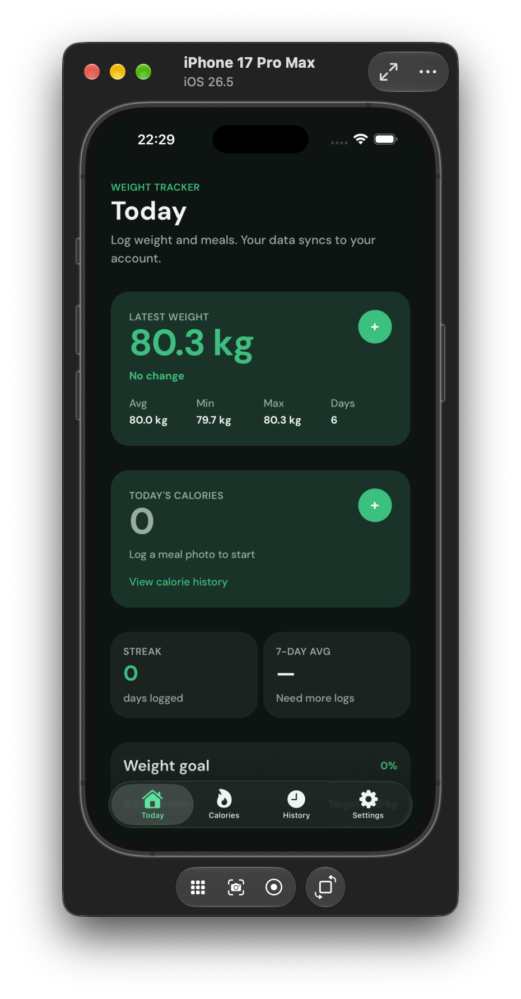
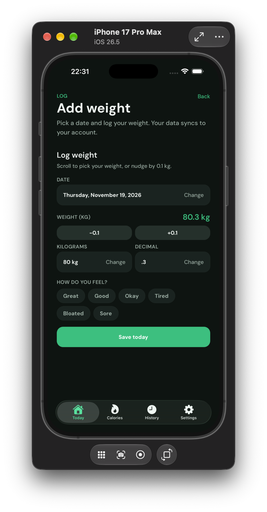
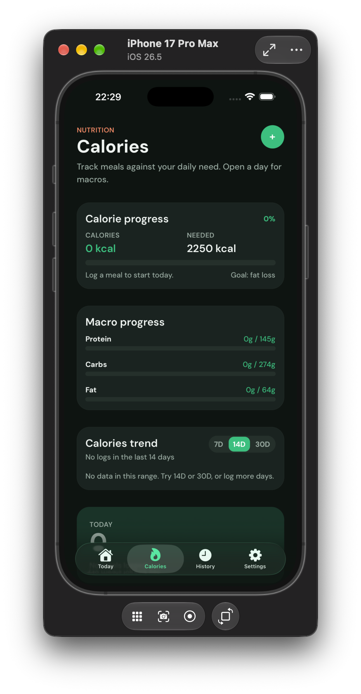
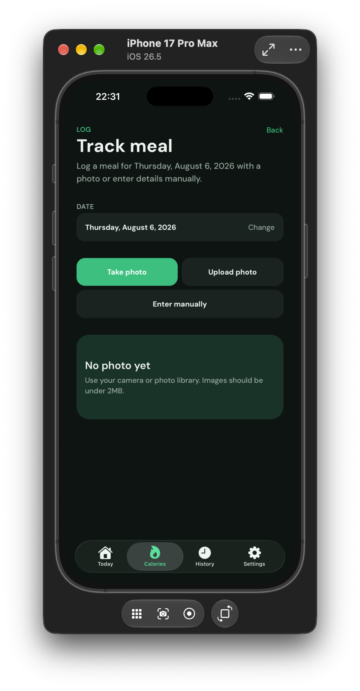
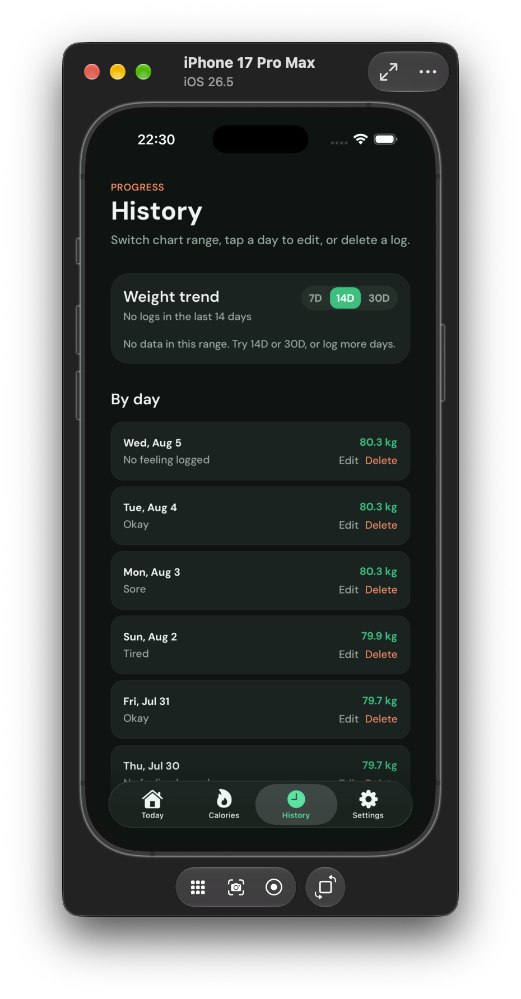
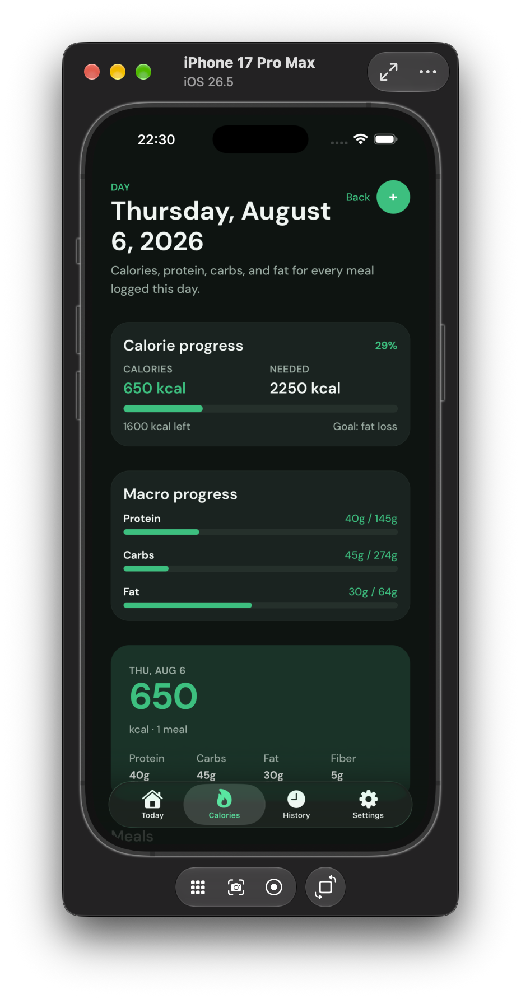
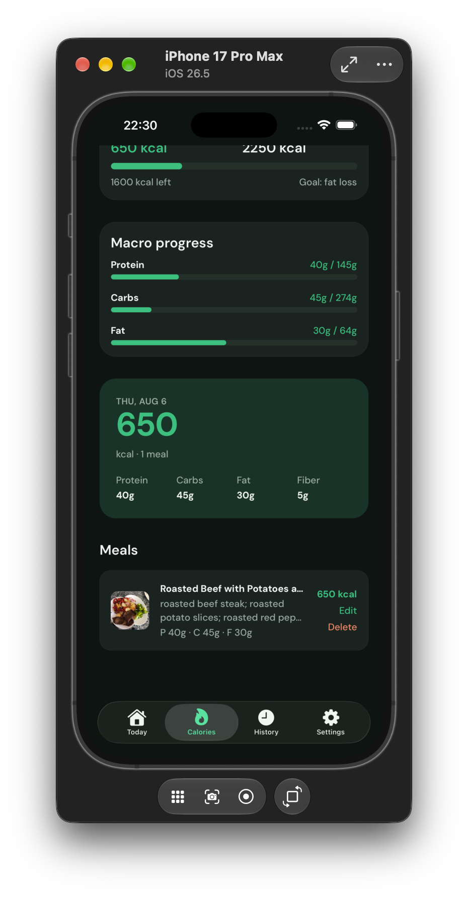

# Weight Tracker

Log daily weight and meals, then follow the trend. The app connects to Supabase for your account and saved logs. A meal photo is sent to a Supabase Edge Function, which uses Groq to estimate calories and macros.

## Supabase and AI meal estimates

Sign-in, weight logs, and meals are stored in Supabase. When you take or upload a meal photo, the app sends it to the `calories_estimate` function. That function only accepts a signed-in user, then asks a Groq vision model to read the photo and return calories, protein, carbs, fat, and fiber. You can still type a meal in by hand.

## Screenshots

  
  
  
  

  
  
  

| Screen | What it shows |
| --- | --- |
| Today | Latest weight, today's calories, streak, and goal progress |
| Add weight | Date, weight picker, and how the day felt |
| Calories | Intake against the daily target, macros, and trend |
| Track meal | Photo capture, library upload, or manual entry |
| History | Weight logs by day, with edit and delete |
| Day | Calories and macros for one day |
| Meal | A logged meal with its photo and nutrition |
